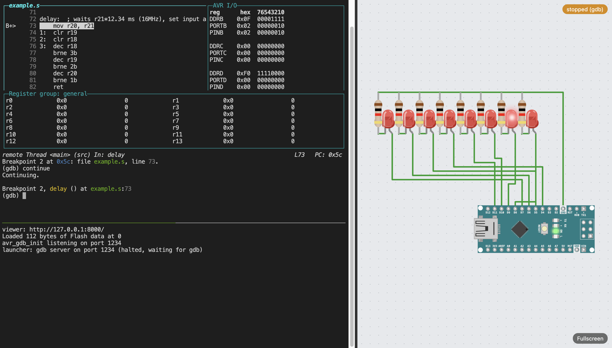

# sim-avr

Simulate and debug ATmega328P (Arduino Nano) assembly projects with one command:
simavr-based simulator + avr-gdb (with an I/O register pane) + a Wokwi-style circuit viewer,
side by side in one browser page, all driven by the same simulation.

Works on macOS and Ubuntu (Windows: use WSL).



## Install: global

Clone the kit once, anywhere:

```sh
git clone https://github.com/ruzgara/sim-avr ~/sim-avr
```

## Install: per project

Without cloning, download the latest `simulation/` folder straight into the project:

```sh
curl -L https://github.com/ruzgara/sim-avr/archive/master.tar.gz \
  | tar -xz --strip-components=1 sim-avr-master/simulation
```

## New project

Each project gets its own copy of the `simulation/` folder:

```sh
mkdir myproject && cd myproject
cp -R ~/sim-avr/simulation .  # or the curl command above
./simulation/setup          # checks/installs dependencies, creates Makefile + myproject.s
make run
```

`setup` never overwrites existing files, so it can also be run in a folder that already has a `.s`.
To update a project's kit later, replace its `simulation/` folder with a newer copy (keep your
`simulation/diagram.json`).

## Usage

By default this tool opens a browser window with gdb debugging the program and the Wokwi-like viewer displaying it. You will need to know the basics of gdb.

[GDB Intro here](https://www.geeksforgeeks.org/c/gdb-step-by-step-introduction/)

> **Note:** the intro starts programs with `run` / `start`. Don't use those here: the program is
> already loaded in the simulator and paused at its first instruction, so just step or continue.

For those familiar with other debuggers, the basics are:

- `si [n]` or `stepi [n]` -> step into (n instructions)
- `ni [n]` or `nexti [n]` -> step over (n instructions)
- `c [n]` -> continue (if stopped at a breakpoint, stop at its nth hit, skipping the ones before)
- `fin` or `finish` -> step out (only works inside a routine entered with `rcall`)
- `b <label>` or `break <label>` -> set a breakpoint, e.g. `b delay`
- `p $r16` or `info registers r16` -> show a register
- `Ctrl-C` -> pause the program while it is running
- `q` or `quit` -> quit gdb (answer `y`), which ends the whole session
- press Enter to repeat the last command

An example debugging session could go like:

```
si
<enter-key>
<enter-key>
si 5
ni
si
<enter-key>
fin
c
c 2
<ctrl-c>
q
y
```

### Timing: the stopwatch

The simulator counts every clock cycle and instruction, so timings are exact: at 16 MHz one
cycle is 62.5 ns, and the time shown is cycles / 16,000,000 (never your computer's clock).
It appears at the top of the AVR I/O pane, as a live clock in the circuit viewer, and with:

- `sw` or `stopwatch` -> show the counters
- `sw reset` -> start a new measurement from here (adds a `reset` line). The **reset** button in
  the circuit viewer does the same; both share one reset point, shown in the pane and the browser

The three lines mean:

- `time` -> total since the program started (only resets when you restart `make run`)
- `lap` -> between the last two stops you saw. Every `c`, `fin`, `si`, `ni` starts a new lap,
  so read it right after the stop you care about
- `reset` -> since the last `sw reset` / reset button

The examples below use the kit's example program (`example/example.s`, a binary counter whose
`delay` is three nested loops with `ldi r20, 20`).

#### Time one call of a routine

Stop when the routine is entered, then step out of it:

```
b delay
c
fin
```

```
lap       246.724 ms
      3,947,584 cyc  2,636,862 ins
```

That is exactly one call of `delay`, from its first instruction through its `ret`. It does not
include the `rcall` that called it (3 cycles). To include it, stop at the call and step over it:

```
b example.s:18      # the line with `rcall delay`
c
ni
```

```
lap       246.724 ms
      3,947,587 cyc  2,636,863 ins
```

#### Time the period between calls

With the breakpoint on `delay`, each `c` runs to the next call, so `lap` is one whole period
(e.g. how long the LEDs show each value): the delay plus the code between calls.

```
c
```

```
lap       246.725 ms
      3,947,598 cyc  2,636,868 ins
```

#### Time several periods

```
sw reset
c 4
```

`c 4` continues until the 4th breakpoint hit from here; `reset` then shows all four periods:

```
reset     986.899 ms
      15,790,392 cyc  10,547,472 ins
```

#### Check it by hand

The stopwatch matches the instruction timings in the ATmega328P datasheet (`dec` 1 cycle, `brne`
2 if taken and 1 if not, `clr`/`ldi` 1, `rcall` 3, `ret` 4). For the example's `delay`:

- inner loop (`dec r18` / `brne`, 256 times): 256 × 3 − 1 = 767 cycles
- middle loop (`clr r18`, inner, `dec r19` / `brne`, 256 times): 256 × 771 − 1 = 197,375 cycles
- outer loop (`clr r19`, middle, `dec r20` / `brne`, N times): N × 197,379 − 1 cycles
- plus `ldi r20, N` (1) and `ret` (4): **197,379 × N + 4 cycles**

With N = 20 that is 3,947,584 cycles = 246.724 ms, exactly what `fin` measured. Each count of N
is 12.336 ms. To hit a target time, work out N (and pad with `nop`s for the last few cycles),
then confirm it with the stopwatch.

`sw` prints the same lines in the command area, which is handy for copying into a report. In the
browser, pressing **reset** while the program is running can be up to 50 ms late (that is how
often the running totals reach the browser); while stopped, and with `sw reset`, it is exact.

## Commands

| command     | what it does                                                         |
|-------------|----------------------------------------------------------------------|
| `make`      | assemble all `*.s` into `NAME.hex` (`.o`/`.elf` go to `simulation/build/`) |
| `make run`  | browser page: tmux session (avr-gdb `layout avr` + simulator) beside the circuit viewer |
| `make run UI=terminal` | tmux session in this terminal, circuit viewer alone in the browser |
| `make sim`  | tmux in this terminal: avr-gdb + simulator, no viewer                |
| `make view` | simulator running freely + circuit viewer, no gdb (Ctrl-C to stop)   |
| `make upload` | upload `NAME.hex` to a real Nano with avrdude (port found automatically) |
| `make clean`| delete build output                                                   |

To make the terminal version the default for a project, add `UI := terminal` to its Makefile.

Quitting gdb (or Ctrl-C in the terminal that ran `make run`) ends the whole session.
Ports: gdb 1234, viewer <http://127.0.0.1:8000/>, terminal (ttyd) 7681.

In the `make run` page:

- the terminal is the real tmux session, served by [ttyd](https://github.com/tsl0922/ttyd);
  `tmux attach -t avr-NAME` attaches to it from a normal terminal as well
- drag the bar between the halves to resize
- closing the tab asks first; the session keeps running and reopening the page reconnects
- **Fullscreen** (bottom right): in Chrome/Edge/Brave/Arc it also sends browser shortcuts such as
  Ctrl-W / Ctrl-T to the terminal instead of the browser (hold Esc to leave) - useful on Linux,
  where Ctrl-W would otherwise close the tab

## Uploading to a real Nano

`make upload` flashes exactly the `.hex` you simulated, using avrdude (`setup` offers to install it).

- The board's USB serial port is found automatically; if there are none or several, give it:
  `make upload PORT=/dev/cu.usbserial-1410` (macOS) or `PORT=/dev/ttyUSB0` (Linux).
- The default is the **old Nano bootloader** (57600 baud), which most clones have. For the new
  bootloader (115200 baud) use `make upload BOOTLOADER=new`, or put `BOOTLOADER := new` in the
  project Makefile. If avrdude can't sync with the board, it suggests the other one.
- Linux: if the port isn't accessible, add yourself to the `dialout` group.

## Existing projects

`setup` leaves an existing `Makefile` alone. If it doesn't include `simulation/avr.mk`, either rename
it (`mv Makefile Makefile.old`) and run `setup` again, or add `NAME := myproject` and
`include simulation/avr.mk` to it. Also note: every `.s` in the folder is linked into one program
(one program per folder), and sources are assembled with plain `avr-as` (use `.equ`, no `#include`).

## The circuit

`simulation/diagram.json` is a Wokwi diagram. Design the circuit on wokwi.com (or edit the file by
hand) and paste the diagram in. The viewer currently understands `wokwi-arduino-nano`,
`wokwi-led` and `wokwi-resistor`. `simulation/wokwi.toml` lets the official Wokwi VS Code extension
run the same project if you want it.

## How it works

`simulation/build/launcher` is a small C program built on
libsimavr that runs the firmware at real-time speed, serves gdb on :1234 and prints port changes;
`viewer/server.py` relays those to the browser, where `viewer.js` draws the circuit with Wokwi's
open-source part artwork (`@wokwi/elements`, MIT) and lights the LEDs.

`example/` is a test project for developing the kit (its `simulation` is a symlink).
